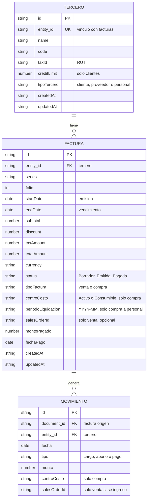

# Modelo de Datos: Facturación y Pagos (Módulo de Contabilidad y Finanzas)

**Rama**: `001-erp-base-module` · **Fecha**: 2026-10-29 · **Estado**: Borrador (actualizado al 2026-11-11 con la Revisión 4 de `spec.md`)
**Relacionado con**: `spec.md` (historias de usuario y requisitos FR-001 a FR-030) y `contracts/entity-storage.md`

## 1. Descripción y justificación de los datos

El módulo debe responder tres preguntas: ¿cuánto me deben mis clientes?, ¿cuánto debo a mis proveedores? y ¿qué está vencido? Para eso bastan tres conceptos, dos de los cuales el template ya ofrece:

| Concepto del módulo | Tipo en el template | Para qué existe |
|---|---|---|
| **Tercero** | Entity (registro de datos maestros) | La contraparte: un cliente (a quien se le cobra), un proveedor (a quien se le paga) o personal (a quien se le liquidan sueldos). |
| **Factura de venta / Factura de compra** | Document (registro transaccional) | La deuda o el cobro: dos documentos separados, cada uno con su listado y reglas propias. |
| **Movimiento financiero** | Registro derivado de los documentos | El rastro trazable de cada emisión y cada pago; de solo lectura y no usado para calcular KPIs. |

**Por qué solo tres.** Cada dato guardado debe servir a una historia de usuario. Todo lo demás (plan de cuentas, asientos, pagos como registro propio) queda para etapas futuras.

**Por qué un solo tipo de entidad y documentos separados.** El template ofrece una entidad y un documento por módulo. Cliente, proveedor y personal comparten los mismos datos base (nombre, código, RUT), así que el Tercero es una sola entidad con un campo de tipo. En cambio, Factura de Venta y Factura de Compra son documentos separados, cada uno con su listado y sus reglas propias (decidido 2026-11-05; el ayudante lo había recomendado): la compra agrega centro de costo y período de liquidación, campos que la venta no tiene.

**Separación lógica y de UI, no de almacenamiento (2026-11-11).** La separación entre venta y compra es visual y funcional: dos vistas, dos formularios y dos listados independientes con columnas propias. El almacenamiento sigue siendo un único `Document` en `erp.documents`, con `customFields.tipoFactura` como discriminante. La vista fija el tipo y el formulario no permite cambiarlo; un documento de venta nunca se muestra en el listado de compra ni viceversa. La separación física en dos colecciones queda fuera del MVP.

**Por qué los pagos son campos de la factura.** En el MVP una factura se paga completa y una sola vez. Un registro de pagos separado solo se justifica cuando existan pagos parciales (etapa futura).

## 2. Tablas y variables críticas

| Variable | Tabla | Por qué es crítica |
|---|---|---|
| `entity_id` | Factura (venta y compra) | Vincula cada factura con su tercero. Sin ella no se puede calcular la deuda por tercero. |
| `tipoTercero` | Tercero | Separa clientes (cobrar), proveedores y personal (pagar). Define qué documentos puede recibir. |
| `tipoFactura` | Factura | Distingue el documento de venta del de compra, que son listados y reglas separadas. |
| `centroCosto` | Factura de compra | Clasifica el gasto entre Activo y Consumible; obligatorio al emitir (solo atributo de reporte). |
| `periodoLiquidacion` | Factura de compra a personal | Obligatorio (`YYYY-MM`) cuando el tercero es de tipo personal. |
| `salesOrderId` | Factura de venta | Trazabilidad hacia el módulo de Ventas. |
| `totalAmount` | Factura | Es el monto de la deuda. |
| `status` | Factura | Define qué cuenta como deuda: solo las facturas Emitidas. |
| `endDate` (vencimiento) | Factura | Permite identificar las facturas vencidas. |
| `montoPagado` y `fechaPago` | Factura | Registran el cierre de la deuda. |
| `creditLimit` y `taxId` | Tercero | Son datos sensibles o que pueden generar sesgos (ver sección 10). |

**Método de análisis.** El MVP usa solo agregaciones simples: sumas de `totalAmount` por tercero y por tipo, y comparación de `endDate` con la fecha de hoy. No hay estimaciones estadísticas. Como desarrollo futuro se podría analizar la antigüedad de los saldos o el riesgo de morosidad; en ese caso habría que revisar los sesgos antes de usar los datos para decidir sobre las personas (ver sección 10).

## 3. Entidad: Entity (Tercero)

Representa al cliente, proveedor o personal. Se muestran todos los campos base del template y su uso en este módulo.

| Campo | Tipo | Descripción | Restricciones | Uso en este módulo |
|---|---|---|---|---|
| id | string | Identificador interno único del registro; el template le da el mismo valor que a `entity_id` | Obligatorio, generado automáticamente | Usado |
| entity_id | string | Identificador público usado para vincular facturas a este tercero | Obligatorio, generado automáticamente, único | Usado |
| name | string | Nombre o razón social | Obligatorio, no vacío | Usado |
| code | string | Código interno del tercero | Obligatorio, no vacío, único (sin distinguir mayúsculas) | Usado |
| taxId | string | Identificación fiscal; aquí, el RUT | Opcional | Usado |
| email | string | Correo de contacto | Opcional; formato válido si se proporciona | Disponible, sin uso en el MVP |
| phone | string | Teléfono de contacto | Opcional | Disponible, sin uso en el MVP |
| address | string | Dirección | Opcional | Disponible, sin uso en el MVP |
| category | string | Clasificación libre | Opcional | Disponible, sin uso en el MVP |
| description | string | Descripción o notas | Opcional | Disponible, sin uso en el MVP |
| targetDate | string | Fecha objetivo (YYYY-MM-DD) | Opcional; fecha válida | Disponible, sin uso en el MVP |
| creditLimit | number | Límite de crédito | Opcional, número no negativo | Usado, solo para clientes |
| paymentTerms | string | Condiciones de pago | Opcional | Disponible, sin uso en el MVP |
| createdAt | string | Marca de tiempo de creación | Obligatorio | Usado (trazabilidad) |
| updatedAt | string | Marca de tiempo de última actualización | Obligatorio | Usado (trazabilidad) |

**Campo personalizado de este módulo:**

| Campo | Tipo | Descripción | Restricciones |
|---|---|---|---|
| tipoTercero | select | Indica si el tercero es cliente, proveedor o personal | Obligatorio. Valores: `cliente`, `proveedor`, `personal` |

## 4. Entidad: Document (Factura de venta y Factura de compra)

Representa una factura de venta (por cobrar) o de compra (por pagar) como documentos separados, vinculadas a un tercero del tipo correspondiente. **En almacenamiento es un único registro `Document`**; la separación es lógica y de interfaz, y se materializa en dos vistas independientes que fijan `tipoFactura`.

| Campo | Tipo | Descripción | Restricciones | Uso en este módulo |
|---|---|---|---|---|
| id | string | Identificador único de la factura; el template le da el mismo valor que a `document_id` | Obligatorio, generado automáticamente | Usado |
| document_id | string | Identificador público de la factura | Obligatorio, generado automáticamente | Usado |
| entity_id | string | `entity_id` del tercero al que pertenece | Obligatorio, debe existir | Usado |
| series | string | Serie de la factura | Opcional | Usado |
| folio | number | Folio que, junto con la serie, forma el número oficial | Obligatorio, entero positivo | Usado |
| startDate | string | Fecha de inicio (YYYY-MM-DD) | Obligatorio, fecha válida | Usado como **fecha de emisión** *(equivalencia por confirmar con el ayudante)* |
| endDate | string | Fecha de fin (YYYY-MM-DD) | Obligatorio, fecha válida, igual o posterior a `startDate` | Usado como **fecha de vencimiento** *(equivalencia por confirmar con el ayudante)* |
| quantity | number | Cantidad asociada | Opcional, entero positivo | Disponible, sin uso en el MVP |
| subtotal | number | Importe antes de descuentos e impuestos | Opcional, no negativo | Usado |
| discount | number | Descuento sobre el subtotal | Opcional, no negativo, no puede superar el subtotal | Usado |
| taxAmount | number | Impuesto del documento | Opcional, no negativo | Usado |
| totalAmount | number | Importe total | Opcional en el template; en este módulo se exige al emitir (decidido 2026-11-03) | Usado |
| currency | string | Código de moneda | Opcional | Usado (una sola moneda en el MVP) |
| paymentTerms | string | Condiciones de pago | Opcional | Disponible, sin uso en el MVP |
| notes | string | Notas libres | Opcional | Disponible, sin uso en el MVP |
| status | string | Estado de la factura | Con el ciclo de vida configurado: Borrador, Emitida o Pagada | Usado |
| createdAt | string | Marca de tiempo de creación | Obligatorio | Usado (trazabilidad) |
| updatedAt | string | Marca de tiempo de última actualización | Obligatorio | Usado (trazabilidad) |

**Campos personalizados de este módulo:**

| Campo | Tipo | Descripción | Restricciones |
|---|---|---|---|
| tipoFactura | select | Indica si es factura de venta (por cobrar) o de compra (por pagar) | Obligatorio. Valores: `venta`, `compra` |
| montoPagado | number | Monto que se pagó | Opcional; obligatorio al marcar Pagada; debe ser igual a `totalAmount` |
| fechaPago | date | Fecha en que se pagó | Opcional; obligatoria al marcar Pagada |
| centroCosto | select | Centro de costo de la compra | Solo facturas de compra. Valores: `Activo`, `Consumible`. Obligatorio al emitir; indefinido solo en Borrador |
| periodoLiquidacion | string | Período de la liquidación de sueldo (YYYY-MM) | Solo facturas de compra a tercero de tipo personal; obligatorio, mes válido no posterior a la fecha de emisión |
| salesOrderId | string | Referencia a la orden de venta (trazabilidad) | Solo facturas de venta; opcional, texto libre no vacío cuando se ingresa |

### 4a. Vistas y columnas por tipo (Revisión 4)

La misma entidad `Document` se proyecta en dos vistas independientes. El tipo no se elige en el formulario: lo fija la vista.

| Elemento | Factura de venta | Factura de compra |
|---|---|---|
| Ruta / vista | `invoice-sale` / `#view-invoice-sale` | `invoice-purchase` / `#view-invoice-purchase` |
| Formulario | `#invoice-sale-form` (`invoice-sale-form.js`) | `#invoice-purchase-form` (`invoice-purchase-form.js`) |
| Listado | `#invoice-sale-list` (`invoice-sale-list.js`) | `#invoice-purchase-list` (`invoice-purchase-list.js`) |
| `tipoFactura` | Fijo en `venta` | Fijo en `compra` |
| Terceros admitidos | `cliente` | `proveedor` o `personal` |
| Campos propios visibles | `salesOrderId` | `centroCosto` y `periodoLiquidacion` (este último solo si el tercero es `personal`) |
| Columnas del listado | Folio, Estado, Emisión, Vencimiento, Total, Orden de venta (`salesOrderId`) | Folio, Estado, Emisión, Vencimiento, Total, Centro de costo, Período de liquidación |
| Estilo distintivo | `.invoice-view--sale`, `.invoice-badge--sale` | `.invoice-view--purchase`, `.invoice-badge--purchase` |

**Invariantes de la proyección:**
- Un documento solo se muestra y se edita en la vista de su `tipoFactura`.
- El formulario inyecta `customFields.tipoFactura` al guardar; no hay control de usuario para cambiarlo.
- Al editar o eliminar desde un listado, la aplicación navega a la vista del tipo del documento.
- La vista genérica de documentos no existe en el menú ni en el HTML.

## 4b. Registro: Movimiento financiero

Generado automáticamente por las emisiones y los pagos, con granularidad de un movimiento por evento (un cargo por emisión de venta, un abono por emisión de compra y una contrapartida por pago). Es de **solo lectura**: no se edita ni se elimina manualmente; al eliminar una factura se eliminan sus movimientos. **No se usa para calcular KPIs**: el home y el seguimiento suman sobre las facturas (FR-021/FR-023).

| Campo | Tipo | Descripción | Restricciones |
|---|---|---|---|
| id | string | Identificador único del movimiento | Obligatorio, generado automáticamente |
| document_id | string | Referencia a la factura que lo originó | Obligatorio, debe existir |
| entity_id | string | Tercero de la factura | Obligatorio, debe existir |
| fecha | string | Fecha del evento (emisión o pago) | Obligatorio |
| tipo | string | Tipo de movimiento | Valores: `cargo` (emisión venta), `abono` (emisión compra), `pago` (contrapartida) |
| monto | number | Monto del movimiento | Obligatorio, no negativo, igual al `totalAmount` de la factura |
| centroCosto | select | Copia del centro de costo de la factura de compra | Solo documentos de compra |
| salesOrderId | string | Copia del `sales_order_id` de la factura de venta | Solo documentos de venta, si se ingresó |

## 5. Configuración del módulo (ModuleConfig)

Así se adapta el template a este módulo, sin tocar el código central:

| Elemento | Valor |
|---|---|
| moduleName | "Contabilidad y Finanzas: Facturación y Pagos" |
| labels | entity: "Tercero", entities: "Terceros", document: "Factura", documents: "Facturas" |
| customFields | tercero: `tipoTercero` (select, obligatorio, opciones cliente, proveedor y personal). venta: `tipoFactura` (`venta`), `montoPagado` (number), `fechaPago` (date), `salesOrderId` (text). compra: `tipoFactura` (`compra`), `montoPagado` (number), `fechaPago` (date), `centroCosto` (select, opciones Activo y Consumible), `periodoLiquidacion` (text, solo personal) |
| statusLifecycle | statuses: Borrador, Emitida, Pagada. Transiciones: Borrador → Emitida; Emitida → Pagada; Pagada → (ninguna) |
| theme | Valor predeterminado |

**Regla de colisión.** Las claves de los campos personalizados no deben chocar con los nombres de campos base (`id`, `entity_id`, `document_id`, `name`, `code`, `taxId`, `email`, `phone`, `address`, `category`, `description`, `targetDate`, `creditLimit`, `paymentTerms`, `series`, `folio`, `startDate`, `endDate`, `quantity`, `subtotal`, `discount`, `taxAmount`, `totalAmount`, `currency`, `notes`, `status`, `customFields`, `createdAt`, `updatedAt`). Las claves de este módulo (`tipoTercero`, `tipoFactura`, `montoPagado`, `fechaPago`, `centroCosto`, `periodoLiquidacion`, `salesOrderId`) no chocan con ninguno. Se usan claves distintas para tercero, venta y compra, en vez de repetir `tipo`, para evitar ambigüedades.

## 6. Relaciones

- Un Tercero tiene cero o muchas Facturas. Cada Factura pertenece exactamente a un Tercero, vinculada por `entity_id` (no por `id`; el tipo de factura determina el tipo de tercero admitido: venta → cliente; compra → proveedor o personal).
- Al eliminar un Tercero se eliminan en cascada sus Facturas y, con ellas, sus Movimientos financieros, previa confirmación (FR-005). Es una regla de la aplicación, no de una base de datos.
- Cada Factura tiene cero, uno o dos Movimientos financieros (cero en Borrador; uno por emisión; uno más por pago), generados automáticamente (FR-017) y vinculados por `document_id`.

## 7. Reglas de validación

**Del template (se mantienen):**

- Un tercero debe tener `name` y `code` no vacíos, y el código no puede repetirse (sin distinguir mayúsculas). El límite de crédito, si existe, no puede ser negativo.
- Una factura debe referenciar un tercero existente por `entity_id`.
- Una factura debe tener `folio` entero positivo, y `endDate` igual o posterior a `startDate`.
- Subtotal, descuento, impuesto y total no pueden ser negativos, y el descuento no puede superar el subtotal.

**Propias de este módulo (no vienen en el template; se implementan en las tareas):**

- Una factura de **venta** solo puede asociarse a un tercero **cliente**, y una de **compra** a un **proveedor** o **personal** (FR-007/FR-012).
- El límite de crédito solo aplica a clientes (FR-003).
- Toda factura nueva inicia en **Borrador** (FR-011).
- Solo se permiten las transiciones Borrador → Emitida → Pagada. No se puede retroceder (FR-011).
- Para pasar a **Pagada**, la factura debe estar Emitida y tener `montoPagado` igual a `totalAmount` y una `fechaPago` (FR-016).
- El total es obligatorio al emitir (FR-008/FR-013).
- El `centroCosto` de la compra es obligatorio al emitir (FR-014).
- El `periodoLiquidacion` es obligatorio (`YYYY-MM`, no posterior a la emisión) solo cuando el tercero es de tipo personal (FR-015).
- El `salesOrderId`, si se ingresa, no puede estar vacío (FR-009).
- El `tipoFactura` lo fija la vista desde la que se crea la factura; el formulario no lo expone y no se puede cambiar después (FR-006).
- Un documento solo se muestra y se edita en la vista de su `tipoFactura`; el listado del otro tipo lo excluye (FR-006).
- La combinación (tipo de documento, serie, folio) es única dentro de su tipo (FR-030).
- Los movimientos financieros se generan automáticamente y no admiten edición ni eliminación manual (FR-019).

## 8. Datos derivados (no se guardan)

Se calculan al mostrar el seguimiento, para no duplicar información (FR-023 a FR-025). **La fuente de cálculo son las facturas; los movimientos financieros no participan.**

| Dato | Cómo se calcula |
|---|---|
| Total por cobrar de un cliente | Suma de `totalAmount` de sus facturas de venta en estado Emitida. |
| Total por pagar a un proveedor | Suma de `totalAmount` de sus facturas de compra en estado Emitida. |
| Factura vencida | Factura en estado Emitida cuyo `endDate` es estrictamente anterior a la fecha de hoy (una factura que vence hoy no está vencida). |

Las facturas en Borrador y las Pagadas no cuentan como deuda.

## 9. Correspondencia con el modelo ERP base del curso

Este módulo simplifica las tablas de Finanzas del modelo ERP base. Esta tabla permite conectarlo después con los otros módulos (llaves compartidas):

| Este módulo | Modelo ERP base | Nota |
|---|---|---|
| Tercero con `tipoTercero` = cliente | `customers` (CRM) | `entity_id` cumple el rol de `customer_id` (llave compartida por acordar, FR-027) |
| Tercero con `tipoTercero` = proveedor | `vendors` (Compras) | `entity_id` cumple el rol de `vendor_id` (llave compartida por acordar, FR-027) |
| Tercero con `tipoTercero` = personal | `employees` (remuneraciones, fuera del MVP) | La factura de compra actúa como instrumento de la liquidación (FR-015) |
| Factura de venta | `ar_invoices` | Con trazabilidad por `salesOrderId` → `sales_order_id` |
| Factura de compra | `ap_invoices` | Con `centroCosto` (Activo/Consumible) y `periodoLiquidacion` cuando aplica |
| Movimiento financiero | `gl_journal` (etapa futura) | En el MVP es un registro propio de solo lectura; los asientos llegan con el plan de cuentas |
| `startDate` | `invoice_date` | Fecha de emisión |
| `endDate` | `due_date` | Fecha de vencimiento |
| `totalAmount` | `total_amount` | |
| `status` | `status` | |
| `montoPagado` y `fechaPago` | `ar_receipts` y `ap_payments` (con sus `applications`) | Simplificado: en el MVP son campos de la factura |
| Referencia a otros módulos (FR-027) | `customer_id`, `vendor_id`, `sales_order_id` y `purchase_order_id` | El `salesOrderId` de la venta guarda el rol de `sales_order_id`; las demás referencias se acordarán con los grupos de CRM y Compras |

## 10. Riesgos de datos y sesgos

- **RUT (`taxId`).** Es un dato personal. Siguiendo el principio de minimización del GDPR, el MVP no pide correo, teléfono ni dirección, y usa solo datos ficticios.
- **Límite de crédito (`creditLimit`).** Fijarlo puede discriminar a ciertos clientes. O'Neil (2016, cap. 8) distingue los puntajes de crédito tradicionales, que miran el historial de pagos y son relativamente transparentes y regulados, de los modelos que usan sustitutos (*proxies*) como el código postal, que pueden discriminar. Por eso el criterio del límite debe basarse en el comportamiento de pago del propio tercero (facturas vencidas, monto adeudado) y no en datos como su ubicación o su nombre. Debe documentarse y poder revisarse. El MVP no decide automáticamente: a lo más avisa (FR-029).
- **Datos de remuneraciones.** La factura de compra a personal asocia montos a trabajadores con solo su período (`YYYY-MM`). No se calculan ni se exponen haberes ni descuentos legales; el RUT de personal es siempre un dato personal.
- **Análisis futuro de morosidad.** Si más adelante se calcula un puntaje o se predice la morosidad, hay que revisar los tres elementos que O'Neil (2016, Introducción) identifica en un modelo dañino: opacidad (el afectado no entiende cómo se calcula), escala (se aplica a muchas personas) y daño (puede perjudicar a quien se evalúa). También hay que evitar los ciclos de retroalimentación, en que la decisión empeora la situación que el modelo mide.
- **Almacenamiento.** `localStorage` no es seguro ni cifrado. No debe usarse con datos reales.

## 11. Almacenamiento

Los datos se guardan en el navegador (`localStorage`) bajo las claves del código del template: `erp.entities` y `erp.documents` (más `erp.schemaVersion`). Los movimientos financieros se guardan en `erp.movements` como registros derivados, regenerables desde las facturas. Los valores de los campos personalizados se guardan dentro del objeto `customFields` de cada registro, sin cambios de esquema. La separación de vistas de la Revisión 4 **no cambia las claves ni el esquema**: venta y compra siguen conviviendo en `erp.documents` y se distinguen por `customFields.tipoFactura`. La carga de datos de demostración (FR-026) usa solo datos ficticios.

## 12. Modelo Entidad-Relación (MER)

La imagen está en `mer.png`. Es el mismo diagrama que este código:

**Nota:** este MER representa el almacenamiento. La separación de la Revisión 4 es una proyección de UI sobre `FACTURA`: dos vistas, dos formularios y dos listados que fijan `tipoFactura`. No hay tablas nuevas ni relaciones nuevas.

## 13. Notas de extensibilidad y desarrollo futuro

- Los campos base mantienen sus nombres y semántica, para que el almacenamiento, la validación y la integridad referencial sigan intactos.
- **Etapa 2:** el pago pasa a ser un registro propio (`PAGO`) ligado a la factura, para permitir pagos parciales y varios pagos por factura.
- **Etapa 3:** plan de cuentas y asientos contables alimentados por las facturas, además de activos fijos y presupuestos.
- **Etapa 4:** referencias a otros módulos (`customers`, `vendors`, `sales_orders`, `purchase_orders`), backend real, roles y permisos.
- **Etapa 5:** si el volumen o los permisos lo justifican, separar el almacenamiento en dos colecciones (`salesInvoices` y `purchaseInvoices`) o en dos tablas con reglas propias. En el MVP la separación es visual y funcional, no física.

## Fuentes

- Template `MDS-BI/Speckit_Template` (campos base, ModuleConfig y reglas de validación).
- Modelo de datos ERP base del curso (`ar_invoices`, `ap_invoices`, `customers`, `vendors`).
- Diapositivas del curso (Modelación de Sistemas, 2026-2): modelos de datos y manejo de riesgos.
- O'Neil, C. (2016). *Weapons of Math Destruction: How Big Data Increases Inequality and Threatens Democracy*. Crown.
