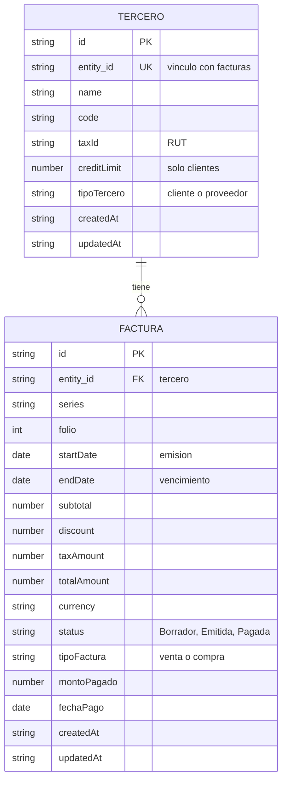

# Modelo de Datos: Facturación y Pagos (Módulo de Contabilidad y Finanzas)

**Rama**: `001-erp-base-module` · **Fecha**: 2026-10-29 · **Estado**: Borrador
**Relacionado con**: `spec.md` (historias de usuario y requisitos FR-001 a FR-019) y `contracts/entity-storage.md`

## 1. Descripción y justificación de los datos

El módulo debe responder tres preguntas: ¿cuánto me deben mis clientes?, ¿cuánto debo a mis proveedores? y ¿qué está vencido? Para eso bastan dos conceptos, que el template ya ofrece:

| Concepto del módulo | Tipo en el template | Para qué existe |
|---|---|---|
| **Tercero** | Entity (registro de datos maestros) | La contraparte: un cliente (a quien se le cobra) o un proveedor (a quien se le paga). |
| **Factura** | Document (registro transaccional) | La deuda o el cobro: una factura de venta (por cobrar) o de compra (por pagar). |

**Por qué solo dos.** Cada dato guardado debe servir a una historia de usuario. Todo lo demás (plan de cuentas, asientos, pagos como registro propio) queda para etapas futuras.

**Por qué un solo tipo de entidad y de documento, cada uno con un campo de tipo.** El template ofrece una entidad y un documento por módulo. Cliente y proveedor comparten los mismos datos (nombre, código, RUT), y la factura de venta y la de compra también. Separarlos duplicaría campos y pantallas sin aportar información nueva. *(Por confirmar con el ayudante.)*

**Por qué los pagos son campos de la factura.** En el MVP una factura se paga completa y una sola vez. Un registro de pagos separado solo se justifica cuando existan pagos parciales (etapa futura).

## 2. Tablas y variables críticas

| Variable | Tabla | Por qué es crítica |
|---|---|---|
| `entity_id` | Factura | Vincula cada factura con su tercero. Sin ella no se puede calcular la deuda por tercero. |
| `tipoTercero` y `tipoFactura` | Tercero y Factura | Separan lo que se cobra (clientes, ventas) de lo que se paga (proveedores, compras). |
| `totalAmount` | Factura | Es el monto de la deuda. |
| `status` | Factura | Define qué cuenta como deuda: solo las facturas Emitidas. |
| `endDate` (vencimiento) | Factura | Permite identificar las facturas vencidas. |
| `montoPagado` y `fechaPago` | Factura | Registran el cierre de la deuda. |
| `creditLimit` y `taxId` | Tercero | Son datos sensibles o que pueden generar sesgos (ver sección 10). |

**Método de análisis.** El MVP usa solo agregaciones simples: sumas de `totalAmount` por tercero y por tipo, y comparación de `endDate` con la fecha de hoy. No hay estimaciones estadísticas. Como desarrollo futuro se podría analizar la antigüedad de los saldos o el riesgo de morosidad; en ese caso habría que revisar los sesgos antes de usar los datos para decidir sobre las personas (ver sección 10).

## 3. Entidad: Entity (Tercero)

Representa al cliente o proveedor. Se muestran todos los campos base del template y su uso en este módulo.

| Campo | Tipo | Descripción | Restricciones | Uso en este módulo |
|---|---|---|---|---|
| id | string | Identificador interno único del registro | Obligatorio, generado automáticamente | Usado |
| entity_id | string | Identificador público usado para vincular facturas a este tercero | Obligatorio, generado automáticamente, único | Usado |
| name | string | Nombre o razón social | Obligatorio, no vacío | Usado |
| code | string | Código interno del tercero | Obligatorio, no vacío | Usado |
| taxId | string | Identificación fiscal; aquí, el RUT | Opcional; se almacena recortada | Usado |
| email | string | Correo de contacto | Opcional; formato válido si se proporciona | Disponible, sin uso en el MVP |
| phone | string | Teléfono de contacto | Opcional | Disponible, sin uso en el MVP |
| address | string | Dirección | Opcional | Disponible, sin uso en el MVP |
| category | string | Clasificación libre | Opcional | Disponible, sin uso en el MVP |
| description | string | Descripción o notas | Opcional | Disponible, sin uso en el MVP |
| targetDate | string | Fecha objetivo (YYYY-MM-DD) | Opcional; fecha válida | Disponible, sin uso en el MVP |
| creditLimit | number | Límite de crédito | Opcional, número no negativo | Usado, solo para clientes |
| paymentTerms | string | Condiciones de pago | Opcional | Disponible, sin uso en el MVP |
| createdAt | string | Marca de tiempo de creación | Obligatorio | Usado (trazabilidad) |
| updatedAt | string | Marca de tiempo de última actualización | Obligatorio | Usado (trazabilidad) |

**Campo personalizado de este módulo:**

| Campo | Tipo | Descripción | Restricciones |
|---|---|---|---|
| tipoTercero | select | Indica si el tercero es cliente o proveedor | Obligatorio. Valores: `cliente`, `proveedor` |

## 4. Entidad: Document (Factura)

Representa una factura de venta (por cobrar) o de compra (por pagar), vinculada a un tercero.

| Campo | Tipo | Descripción | Restricciones | Uso en este módulo |
|---|---|---|---|---|
| id | string | Identificador único de la factura | Obligatorio, generado automáticamente | Usado |
| entity_id | string | `entity_id` del tercero al que pertenece | Obligatorio, debe existir | Usado |
| series | string | Serie de la factura | Opcional | Usado |
| folio | number | Folio que, junto con la serie, forma el número oficial | Obligatorio, entero positivo | Usado |
| startDate | string | Fecha de inicio (YYYY-MM-DD) | Obligatorio, fecha válida | Usado como **fecha de emisión** *(por confirmar)* |
| endDate | string | Fecha de fin (YYYY-MM-DD) | Obligatorio, fecha válida, igual o posterior a `startDate` | Usado como **fecha de vencimiento** *(por confirmar)* |
| quantity | number | Cantidad asociada | Opcional, entero positivo | Disponible, sin uso en el MVP |
| subtotal | number | Importe antes de descuentos e impuestos | Opcional, no negativo | Usado |
| discount | number | Descuento sobre el subtotal | Opcional, no negativo, no puede superar el subtotal | Usado |
| taxAmount | number | Impuesto del documento | Opcional, no negativo | Usado |
| totalAmount | number | Importe total | Opcional en el template; en este módulo se exige al emitir *(por confirmar)* | Usado |
| currency | string | Código de moneda | Opcional | Usado (una sola moneda en el MVP) |
| paymentTerms | string | Condiciones de pago | Opcional | Disponible, sin uso en el MVP |
| notes | string | Notas libres | Opcional | Disponible, sin uso en el MVP |
| status | string | Estado de la factura | Con el ciclo de vida configurado: Borrador, Emitida o Pagada | Usado |
| createdAt | string | Marca de tiempo de creación | Obligatorio | Usado (trazabilidad) |
| updatedAt | string | Marca de tiempo de última actualización | Obligatorio | Usado (trazabilidad) |

**Campos personalizados de este módulo:**

| Campo | Tipo | Descripción | Restricciones |
|---|---|---|---|
| tipoFactura | select | Indica si es factura de venta (por cobrar) o de compra (por pagar) | Obligatorio. Valores: `venta`, `compra` |
| montoPagado | number | Monto que se pagó | Opcional; obligatorio al marcar Pagada; debe ser igual a `totalAmount` |
| fechaPago | date | Fecha en que se pagó | Opcional; obligatoria al marcar Pagada |

## 5. Configuración del módulo (ModuleConfig)

Así se adapta el template a este módulo, sin tocar el código central:

| Elemento | Valor |
|---|---|
| moduleName | "Contabilidad y Finanzas: Facturación y Pagos" |
| labels | entity: "Tercero", entities: "Terceros", document: "Factura", documents: "Facturas" |
| customFields | `tipoTercero` (entity, select, obligatorio, opciones cliente y proveedor); `tipoFactura` (document, select, obligatorio, opciones venta y compra); `montoPagado` (document, number); `fechaPago` (document, date) |
| statusLifecycle | statuses: Borrador, Emitida, Pagada. Transiciones: Borrador → Emitida; Emitida → Pagada; Pagada → (ninguna) |
| theme | Valor predeterminado |

**Regla de colisión.** Las claves de los campos personalizados no deben chocar con los nombres de campos base (`id`, `entity_id`, `name`, `code`, `taxId`, `email`, `phone`, `address`, `category`, `description`, `targetDate`, `creditLimit`, `paymentTerms`, `series`, `folio`, `startDate`, `endDate`, `quantity`, `subtotal`, `discount`, `taxAmount`, `totalAmount`, `currency`, `notes`, `status`). Las cuatro claves de este módulo (`tipoTercero`, `tipoFactura`, `montoPagado`, `fechaPago`) no chocan con ninguno. Se usan claves distintas para tercero y factura, en vez de repetir `tipo`, para evitar ambigüedades.

## 6. Relaciones

- Un Tercero tiene cero o muchas Facturas. Cada Factura pertenece exactamente a un Tercero, vinculada por `entity_id` (no por `id`).
- Al eliminar un Tercero se eliminan en cascada sus Facturas, previa confirmación (FR-005). Es una regla de la aplicación, no de una base de datos.

## 7. Reglas de validación

**Del template (se mantienen):**

- Un tercero debe tener `name` y `code` no vacíos. El límite de crédito, si existe, no puede ser negativo.
- Una factura debe referenciar un tercero existente por `entity_id`.
- Una factura debe tener `folio` entero positivo, y `endDate` igual o posterior a `startDate`.
- Subtotal, descuento, impuesto y total no pueden ser negativos, y el descuento no puede superar el subtotal.

**Propias de este módulo (no vienen en el template; se implementan en las tareas):**

- Una factura de **venta** solo puede asociarse a un tercero **cliente**, y una de **compra** a un **proveedor**.
- El límite de crédito solo aplica a clientes.
- Toda factura nueva inicia en **Borrador** (FR-009).
- Solo se permiten las transiciones Borrador → Emitida → Pagada. No se puede retroceder (FR-010).
- Para pasar a **Pagada**, la factura debe estar Emitida y tener `montoPagado` igual a `totalAmount` y una `fechaPago` (FR-011).
- El total es obligatorio al emitir *(por confirmar)*.

## 8. Datos derivados (no se guardan)

Se calculan al mostrar el seguimiento, para no duplicar información (FR-012 a FR-014):

| Dato | Cómo se calcula |
|---|---|
| Total por cobrar de un cliente | Suma de `totalAmount` de sus facturas de venta en estado Emitida. |
| Total por pagar a un proveedor | Suma de `totalAmount` de sus facturas de compra en estado Emitida. |
| Factura vencida | Factura en estado Emitida cuyo `endDate` es anterior a la fecha de hoy. |

Las facturas en Borrador y las Pagadas no cuentan como deuda.

## 9. Correspondencia con el modelo ERP base del curso

Este módulo simplifica las tablas de Finanzas del modelo ERP base. Esta tabla permite conectarlo después con los otros módulos (llaves compartidas):

| Este módulo | Modelo ERP base | Nota |
|---|---|---|
| Tercero con `tipoTercero` = cliente | `customers` (CRM) | `entity_id` cumple el rol de `customer_id` (llave compartida por acordar, FR-016) |
| Tercero con `tipoTercero` = proveedor | `vendors` (Compras) | `entity_id` cumple el rol de `vendor_id` (llave compartida por acordar, FR-016) |
| Factura con `tipoFactura` = venta | `ar_invoices` | |
| Factura con `tipoFactura` = compra | `ap_invoices` | |
| `startDate` | `invoice_date` | Fecha de emisión |
| `endDate` | `due_date` | Fecha de vencimiento |
| `totalAmount` | `total_amount` | |
| `status` | `status` | |
| `montoPagado` y `fechaPago` | `ar_receipts` y `ap_payments` (con sus `applications`) | Simplificado: en el MVP son campos de la factura |
| Referencia a otros módulos (FR-016) | `customer_id`, `vendor_id`, `sales_order_id` y `purchase_order_id` | El campo que guardará estas referencias se definirá cuando se acuerde el identificador con los grupos de CRM, Ventas y Compras |

## 10. Riesgos de datos y sesgos

- **RUT (`taxId`).** Es un dato personal. Siguiendo el principio de minimización del GDPR, el MVP no pide correo, teléfono ni dirección, y usa solo datos ficticios.
- **Límite de crédito (`creditLimit`).** Fijarlo puede discriminar a ciertos clientes. O'Neil (2016, cap. 8) distingue los puntajes de crédito tradicionales, que miran el historial de pagos y son relativamente transparentes y regulados, de los modelos que usan sustitutos (*proxies*) como el código postal, que pueden discriminar. Por eso el criterio del límite debe basarse en el comportamiento de pago del propio tercero (facturas vencidas, monto adeudado) y no en datos como su ubicación o su nombre. Debe documentarse y poder revisarse. El MVP no decide automáticamente: a lo más avisa (FR-018, por definir).
- **Análisis futuro de morosidad.** Si más adelante se calcula un puntaje o se predice la morosidad, hay que revisar los tres elementos que O'Neil (2016, cap. 1) identifica en un modelo dañino: opacidad (el afectado no entiende cómo se calcula), escala (se aplica a muchas personas) y daño (puede perjudicar a quien se evalúa). También hay que evitar los ciclos de retroalimentación, en que la decisión empeora la situación que el modelo mide.
- **Almacenamiento.** `localStorage` no es seguro ni cifrado. No debe usarse con datos reales.

## 11. Almacenamiento

Los datos se guardan en el navegador (`localStorage`) bajo las claves del template: `erp_base_module:entities` y `erp_base_module:documents`. Los valores de los campos personalizados se guardan junto a los campos base, sin cambios de esquema. La carga de datos de demostración (FR-015) usa solo datos ficticios.

## 12. Modelo Entidad-Relación (MER)

La imagen está en `mer.png`. Es el mismo diagrama que este código:

## 13. Notas de extensibilidad y desarrollo futuro

- Los campos base mantienen sus nombres y semántica, para que el almacenamiento, la validación y la integridad referencial sigan intactos.
- **Etapa 2:** el pago pasa a ser un registro propio (`PAGO`) ligado a la factura, para permitir pagos parciales y varios pagos por factura.
- **Etapa 3:** plan de cuentas y asientos contables alimentados por las facturas, además de activos fijos y presupuestos.
- **Etapa 4:** referencias a otros módulos (`customers`, `vendors`, `sales_orders`, `purchase_orders`), backend real, roles y permisos.

## Fuentes

- Template `MDS-BI/Speckit_Template` (campos base, ModuleConfig y reglas de validación).
- Modelo de datos ERP base del curso (`ar_invoices`, `ap_invoices`, `customers`, `vendors`).
- Diapositivas del curso (Modelación de Sistemas, 2026-2): modelos de datos y manejo de riesgos.
- O'Neil, C. (2016). *Weapons of Math Destruction: How Big Data Increases Inequality and Threatens Democracy*. Crown.
