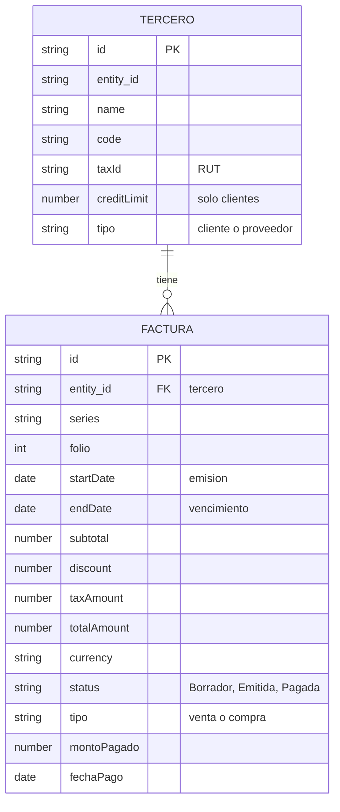

# Modelo de Datos: Facturación y Pagos (Módulo de Contabilidad y Finanzas)

**Rama**: `001-erp-base-module` · **Fecha**: 2026-10-29 · **Estado**: Borrador
**Relacionado con**: `spec.md` (historias de usuario y requisitos FR-001 a FR-019)

## 1. Descripción y justificación de los datos

El módulo necesita responder tres preguntas: ¿cuánto me deben mis clientes?, ¿cuánto debo a mis proveedores? y ¿qué está vencido? Para eso basta con dos conceptos, que el template ya ofrece:

| Concepto del módulo | Tipo en el template | Para qué existe |
|---|---|---|
| **Tercero** | Entidad | Es la contraparte: un cliente (a quien se le cobra) o un proveedor (a quien se le paga). |
| **Factura** | Documento | Es la deuda o el cobro: una factura de venta (por cobrar) o de compra (por pagar). |

**Por qué solo dos.** Cada dato guardado debe servir a una historia de usuario. Todo lo demás (plan de cuentas, asientos, pagos como registro propio) queda para etapas futuras y no se modela ahora.

**Por qué un solo tipo de entidad y de documento, con un campo `tipo`.** El template permite una entidad y un documento por módulo. Cliente y proveedor comparten los mismos datos (nombre, código, RUT), y la factura de venta y la de compra también. *(Por confirmar con el ayudante.)*

## 2. Entidad: Tercero

Campos del template que usa el módulo:

| Campo | Tipo | Obligatorio | Uso en el módulo |
|---|---|---|---|
| `id` | texto | sí (automático) | Identificador interno. |
| `entity_id` | texto | sí (automático) | Vínculo con las facturas. |
| `name` | texto | sí | Nombre o razón social. |
| `code` | texto | sí | Código interno del tercero. |
| `taxId` | texto | no | RUT. Dato personal (ver sección 7). |
| `creditLimit` | número ≥ 0 | no | Límite de crédito. Solo aplica a clientes. |
| `createdAt`, `updatedAt` | fecha-hora | sí (automático) | Trazabilidad. |

Campo personalizado (nuevo):

| Campo | Tipo | Obligatorio | Valores |
|---|---|---|---|
| `tipo` | selección | sí | `cliente`, `proveedor` |

## 3. Documento: Factura

Campos del template que usa el módulo:

| Campo | Tipo | Obligatorio | Uso en el módulo |
|---|---|---|---|
| `id` | texto | sí (automático) | Identificador interno. |
| `entity_id` | texto | sí | Tercero al que pertenece la factura. |
| `series` | texto | no | Serie de la factura. |
| `folio` | entero > 0 | sí | Número de la factura. Junto con la serie forma el número oficial. |
| `startDate` | fecha | sí | **Fecha de emisión.** *(Por confirmar.)* |
| `endDate` | fecha ≥ `startDate` | sí | **Fecha de vencimiento.** *(Por confirmar.)* |
| `subtotal` | número ≥ 0 | no | Monto antes de descuento e impuesto. |
| `discount` | número ≥ 0 | no | Descuento. No puede superar el subtotal. |
| `taxAmount` | número ≥ 0 | no | Impuesto (IVA). |
| `totalAmount` | número ≥ 0 | sí al emitir | Monto total de la factura. |
| `currency` | texto | no | Moneda. El MVP usa una sola. |
| `status` | texto | sí | `Borrador`, `Emitida` o `Pagada`. |
| `createdAt`, `updatedAt` | fecha-hora | sí (automático) | Trazabilidad. |

Campos personalizados (nuevos):

| Campo | Tipo | Obligatorio | Valores / regla |
|---|---|---|---|
| `tipo` | selección | sí | `venta` (por cobrar) o `compra` (por pagar) |
| `montoPagado` | número ≥ 0 | solo al pagar | Debe ser igual a `totalAmount` para pasar a Pagada. |
| `fechaPago` | fecha | solo al pagar | Fecha en que se pagó. |

**Nota.** Los nombres de los campos personalizados no pueden coincidir con los del template. `tipo`, `montoPagado` y `fechaPago` no coinciden con ninguno.

## 4. Relaciones y reglas

- Un Tercero tiene **cero o muchas** Facturas. Una Factura pertenece a **un solo** Tercero.
- Al eliminar un Tercero se eliminan sus Facturas, previa confirmación (FR-005).
- Una factura de **venta** solo puede asociarse a un tercero **cliente**, y una de **compra** a uno **proveedor**. *(Regla propuesta; falta agregarla al spec.)*
- El límite de crédito solo aplica a terceros de tipo cliente.

## 5. Ciclo de vida de la factura

```
Borrador → Emitida → Pagada
```

- Toda factura nace en **Borrador**.
- Solo se permiten esas dos transiciones. No se retrocede y **Pagada** es el estado final (FR-009 y FR-010).
- Para pasar a **Pagada** hay que registrar `montoPagado` igual a `totalAmount` y una `fechaPago` (FR-011).

## 6. Datos derivados (no se guardan)

Se calculan al mostrar el seguimiento, para no duplicar información (FR-012 a FR-014):

| Dato | Cómo se calcula |
|---|---|
| Total por cobrar de un cliente | Suma de `totalAmount` de sus facturas de venta en estado Emitida. |
| Total por pagar a un proveedor | Suma de `totalAmount` de sus facturas de compra en estado Emitida. |
| Factura vencida | Factura en estado Emitida cuyo `endDate` es anterior a la fecha de hoy. |

Las facturas en Borrador y las Pagadas no cuentan como deuda.

## 7. Riesgos de datos y sesgos

- **RUT (`taxId`).** Es un dato personal. En el MVP se usan solo datos ficticios.
- **Límite de crédito (`creditLimit`).** Fijarlo puede discriminar a ciertos clientes. Debe documentarse con qué criterio se define y cómo se revisa.
- **Almacenamiento.** `localStorage` no es seguro ni cifrado. No debe usarse con datos reales.

## 8. Almacenamiento

Los datos se guardan en el navegador (`localStorage`) bajo las claves del template: `erp_base_module:entities` y `erp_base_module:documents`. La carga de datos de demostración (FR-015) usa solo datos ficticios.

## 9. Modelo Entidad-Relación (MER)



## 10. Desarrollo futuro (fuera del MVP)

- **Etapa 2:** el pago pasa a ser un registro propio (`PAGO`) ligado a la factura, para permitir pagos parciales y varios pagos por factura.
- **Etapa 3:** plan de cuentas y asientos contables alimentados por las facturas.
- **Etapa 4:** referencias a otros módulos (`customers`, `vendors`, `sales_orders`, `purchase_orders`) y backend real.
