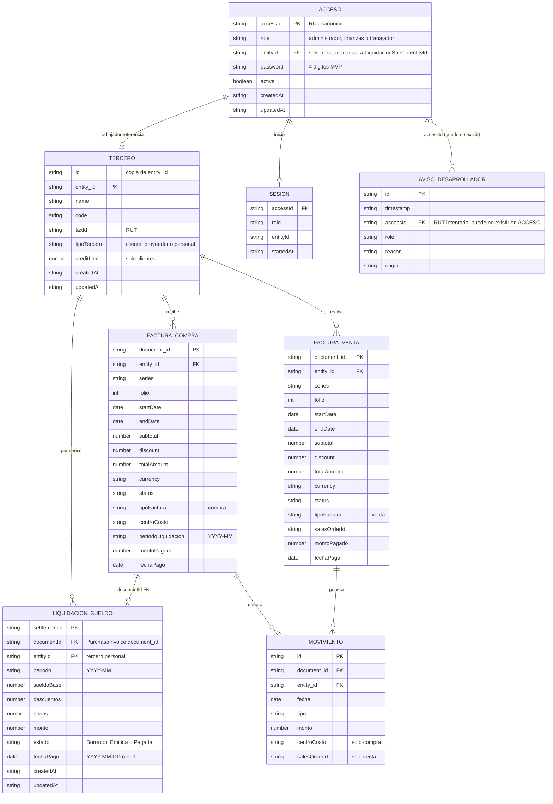

# Modelo de Datos: Acceso a liquidaciones de sueldo por RUT y contraseña

**Rama**: `002-payroll-access-control` · **Fecha**: 2026-11-11 · **Revisado**: 2026-11-19 · **Estado**: Borrador
**Relacionado con**: `spec.md`, `plan.md`, `research.md` y `contracts/`

## 1. Descripción general

El modelo agrega credenciales de acceso, una sesión por pestaña y una entidad persistente de liquidación de sueldo. La liquidación se registra en `LiquidacionSueldo`, se guarda en `erp.payrollSettlements` y se vincula por `documentId` a una factura de compra dirigida a un tercero de tipo personal; la factura sigue siendo el comprobante de pago y la entidad nueva guarda el desglose (sueldo base, descuentos y bonos). No se introduce cálculo legal ni de haberes: esos valores solo se registran y se muestran. Las facturas de venta y de compra se guardan en colecciones separadas.

| Concepto | Tipo | Para qué existe |
|---|---|---|
| **Acceso (AccessRecord)** | Registro de credencial | Identifica a un administrador, finanzas o trabajador por RUT y contraseña. |
| **Sesión (Session)** | Registro efímero en `sessionStorage` | Mantiene el rol y el vínculo mientras la pestaña está abierta. |
| **Notificación al desarrollador (DevNotification)** | Registro local de incidencia | Diagnostica RUT inválidos, duplicados, inactivos o con vínculo roto. |
| **Tercero (Entity)** | Registro de datos maestros existente | Contraparte; el tercero de tipo personal es el trabajador de la liquidación. |
| **Factura de venta (SaleInvoice)** | Registro transaccional | Documento por cobrar, en su propia colección. |
| **Factura de compra (PurchaseInvoice)** | Registro transaccional | Documento por pagar; comprobante de pago de la liquidación cuando el tercero es personal. |
| **Liquidación de sueldo (LiquidacionSueldo)** | Registro persistente en `erp.payrollSettlements` | Desglose, monto, estado y fecha de pago de la liquidación, vinculado por `documentId` a la factura de compra. |
| **Movimiento financiero (Movement)** | Registro derivado existente | Trazabilidad de emisiones y pagos; no se modifica su contrato. |

## 2. Entidad: AccessRecord (Acceso)

Credencial de entrada del MVP. Se guarda en `erp.accessRecords`.

| Campo | Tipo | Descripción | Restricciones |
|---|---|---|---|
| `accessId` | string | RUT canónico del usuario; clave primaria | Obligatorio, único, válido según `isValidRutChileno`, forma `CUERPO-DV` sin puntos. |
| `role` | string | Rol del usuario | Obligatorio. Valores: `administrador` (RRHH), `finanzas`, `trabajador`. |
| `entityId` | string \| null | `entity_id` del tercero personal asociado | Obligatorio para `trabajador`; debe existir y tener `tipoTercero = personal`. `null` para `administrador` y `finanzas`. |
| `password` | string | Contraseña del MVP | Obligatoria, exactamente 4 dígitos. Al crear o restablecer debe ser igual a los primeros 4 dígitos del cuerpo del RUT. |
| `active` | boolean | Estado del acceso | Obligatorio. `true` por defecto. |
| `createdAt` | string | Fecha de creación (ISO 8601) | Obligatorio. |
| `updatedAt` | string | Fecha de última actualización (ISO 8601) | Obligatorio. |

**Invariantes**:
- `accessId` es único entre todos los accesos, comparado en forma canónica.
- Un `entityId` puede tener como máximo un acceso con `active = true`.
- Debe existir al menos un acceso con `role = administrador` y `active = true`.
- Un acceso de administrador o de finanzas no puede tener `entityId`.
- Un acceso de trabajador no puede quedar sin `entityId` ni apuntar a un tercero que no sea personal.
- La contraseña inicial y la restablecida se derivan del RUT; no se acepta otra en la creación. Sin cambio de contraseña en el MVP, es un riesgo conocido documentado.
- En los datos de demostración, el `accessId` del administrador (`88.888.888-8`) no puede coincidir con el `taxId` de ningún `Entity`.
- La asociación con las liquidaciones de un trabajador se resuelve por `AccessRecord.entityId === LiquidacionSueldo.entityId`, no por `PurchaseInvoice.entity_id`.

## 3. Entidad: Session (Sesión)

Registro efímero en `sessionStorage` bajo `erp.session`. No se guarda en `localStorage`.

| Campo | Tipo | Descripción | Restricciones |
|---|---|---|---|
| `accessId` | string | RUT canónico del acceso autenticado | Obligatorio. |
| `role` | string | Rol de la sesión | Obligatorio. Valores: `administrador`, `finanzas`, `trabajador`. |
| `entityId` | string \| null | Tercero personal asociado | Obligatorio para `trabajador`; `null` para `administrador` y `finanzas`. |
| `startedAt` | string | Inicio de la sesión (ISO 8601) | Obligatorio. |

**Ciclo de vida**:
1. Se crea al validar credenciales y rol.
2. Se conserva al recargar la página dentro de la misma pestaña.
3. Se elimina al cerrar sesión.
4. El navegador la elimina al cerrar la pestaña.
5. Si al recuperarla el acceso ya no existe, está inactivo o cambió de rol, se descarta y se vuelve al login.
6. No existe sesión de invitado: sin `Session` válida, toda vista distinta de `login` se considera inalcanzable.

## 4. Entidad: DevNotification (Notificación al desarrollador)

Registro local en `erp.devNotifications`.

| Campo | Tipo | Descripción | Restricciones |
|---|---|---|---|
| `id` | string | Identificador único | Obligatorio, generado automáticamente. |
| `timestamp` | string | Fecha y hora del intento (ISO 8601) | Obligatorio. |
| `accessId` | string | RUT intentado, normalizado si es posible | Obligatorio; puede ser el texto original si el RUT es inválido. |
| `role` | string | Rol del acceso relacionado con el intento | Obligatorio. Valores: `administrador`, `finanzas`, `trabajador` o `desconocido`. |
| `reason` | string | Motivo del rechazo | Obligatorio. Valores: `INVALID_RUT`, `INACTIVE`, `DUPLICATE`, `BROKEN_ENTITY_LINK`, `NOT_FOUND`. |
| `origin` | string | Origen del intento | Obligatorio. Valor inicial: `login`. |

**Reglas**:
- Se registra una notificación por cada intento rechazado por las razones indicadas.
- No se registra una notificación por contraseña incorrecta ni por rol incompatible; esos son errores del usuario, no incidencias del desarrollador.
- El panel de avisos solo es visible para administradores; el rol `finanzas` no puede abrirlo.
- Las notificaciones no se eliminan automáticamente en el MVP; el administrador puede limpiarlas con confirmación.

## 5. Entidad: LiquidacionSueldo (Liquidación de sueldo)

Se guarda en `erp.payrollSettlements`, de forma aditiva a las colecciones de facturas. Cada registro se vincula por `documentId` a un `PurchaseInvoice` y por `entityId` a un `Entity` personal. La factura de compra sigue siendo el comprobante de pago; la entidad propia guarda el desglose registrado. No se introduce cálculo legal ni de haberes: `sueldoBase`, `descuentos` y `bonos` solo se registran y se muestran.

| Campo | Tipo | Descripción | Restricciones |
|---|---|---|---|
| `settlementId` | string | Identificador único de la liquidación | Obligatorio, único en `erp.payrollSettlements`. |
| `documentId` | string | FK a `PurchaseInvoice.document_id` | Obligatorio; la factura debe existir. Una sola liquidación por `documentId`. |
| `entityId` | string | `entity_id` del tercero personal | Obligatorio; debe existir y tener `customFields.tipoTercero === 'personal'`; coincide con `PurchaseInvoice.entity_id`. |
| `periodo` | string | Período de la liquidación | Obligatorio, `YYYY-MM`; no posterior a la emisión de la factura vinculada. |
| `sueldoBase` | number | Sueldo base registrado | Obligatorio, `>= 0`; solo se registra y muestra, sin cálculo legal. |
| `descuentos` | number | Descuentos registrados | Obligatorios, `>= 0`; solo se registran y muestran. |
| `bonos` | number | Bonos registrados | Obligatorios, `>= 0`; solo se registran y muestran. |
| `monto` | number | Monto de la liquidación | Obligatorio, `> 0`; refleja `PurchaseInvoice.totalAmount`. |
| `estado` | string | Estado del ciclo de vida | Obligatorio. Valores: `Borrador` \| `Emitida` \| `Pagada`; refleja `PurchaseInvoice.status`. |
| `fechaPago` | string \| null | Fecha de pago | `YYYY-MM-DD` o `null`; refleja `customFields.fechaPago` de la factura vinculada. |
| `createdAt` | string | Fecha de creación (ISO 8601) | Obligatorio. |
| `updatedAt` | string | Fecha de última actualización (ISO 8601) | Obligatorio. |

**Invariantes**:
- `settlementId` es único y existe como máximo una `LiquidacionSueldo` por `documentId`.
- `entityId` debe corresponder a un `Entity` con `customFields.tipoTercero === 'personal'`.
- La factura vinculada debe tener `customFields.tipoFactura === 'compra'` y `entity_id === entityId`.
- `estado`, `fechaPago` y `monto` son espejo de `status`, `customFields.fechaPago` y `totalAmount` de la factura vinculada; se sincronizan cuando la factura se edita.
- No se calculan haberes, AFP, salud, descuentos legales ni imponibilidad; los valores del desglose se muestran tal como se registraron.
- El nombre y el RUT del trabajador se obtienen de `Entity.name` y `Entity.taxId`, y las fechas de emisión y vencimiento de la factura vinculada, sin duplicarlos en la colección.

**Liquidación vigente del trabajador**:
1. Filtrar las liquidaciones por `entityId === session.entityId`.
2. Ordenar por `periodo` descendente.
3. Desempatar por `startDate` de la factura vinculada descendente.
4. Desempatar por `createdAt` descendente.
5. Mostrar solo la primera; no se exige estado `Pagada`. Si no hay resultados, se muestra un estado vacío claro.

**Historial de pagos del trabajador**:
1. Partir del mismo filtro por `entityId === session.entityId`.
2. Filtrar `estado === 'Pagada' && fechaPago` no vacía.
3. Ordenar por `fechaPago` descendente.
4. Desempatar por `periodo` descendente.
5. Cada fila muestra fecha de pago, período, monto y estado; el desglose (`sueldoBase`, `descuentos`, `bonos`) se muestra solo en la liquidación vigente.

**Regla del administrador y de finanzas**: ambos listan y editan la entidad `LiquidacionSueldo` junto con su factura de compra vinculada, sin límite de período, y pueden filtrar por trabajador/RUT y por período. La asociación con el acceso del trabajador usa `AccessRecord.entityId === LiquidacionSueldo.entityId`, no `PurchaseInvoice.entity_id`. El trabajador ve solo sus propias liquidaciones, en modo solo lectura.

## 6. Entidades de facturación (existentes, con separación física)

### 6.1 SaleInvoice (Factura de venta)

Se guarda en `erp.salesInvoices`. Conserva los campos base de `Document` de `001` y la invariante `customFields.tipoFactura = 'venta'`.

| Campo | Tipo | Restricciones |
|---|---|---|
| `document_id` | string | Obligatorio, único dentro de la colección. |
| `entity_id` | string | Obligatorio; debe existir y ser de tipo `cliente`. |
| `series`, `folio` | string, number | Folio entero positivo; combinación serie/folio única dentro del tipo. |
| `startDate`, `endDate` | string | Fechas válidas; `endDate >= startDate`. |
| `subtotal`, `discount`, `taxAmount`, `totalAmount` | number | No negativos; descuento no mayor que subtotal; total obligatorio al emitir. |
| `status` | string | Borrador, Emitida o Pagada, según el ciclo de vida. |
| `customFields.tipoFactura` | string | Fijo en `venta`. |
| `customFields.salesOrderId` | string | Opcional; si se ingresa, no vacío. |

### 6.2 PurchaseInvoice (Factura de compra)

Se guarda en `erp.purchaseInvoices`. Conserva los campos base de `Document` de `001` y la invariante `customFields.tipoFactura = 'compra'`. Sigue siendo el comprobante de pago; las liquidaciones a personal se vinculan desde `erp.payrollSettlements` por `documentId`.

| Campo | Tipo | Restricciones |
|---|---|---|
| `document_id` | string | Obligatorio, único dentro de la colección. |
| `entity_id` | string | Obligatorio; debe existir y ser de tipo `proveedor` o `personal`. |
| `series`, `folio` | string, number | Folio entero positivo; combinación serie/folio única dentro del tipo. |
| `startDate`, `endDate` | string | Fechas válidas; `endDate >= startDate`. |
| `subtotal`, `discount`, `taxAmount`, `totalAmount` | number | No negativos; descuento no mayor que subtotal; total obligatorio al emitir. |
| `status` | string | Borrador, Emitida o Pagada. |
| `customFields.tipoFactura` | string | Fijo en `compra`. |
| `customFields.centroCosto` | string | `Activo` o `Consumible`; obligatorio al emitir. |
| `customFields.periodoLiquidacion` | string | `YYYY-MM`; obligatorio cuando el tercero es personal y no posterior a la emisión. |
| `customFields.montoPagado`, `customFields.fechaPago` | number, date | Obligatorios al marcar Pagada; `montoPagado = totalAmount`. |

Al editar `status`, `customFields.fechaPago` o `totalAmount` de una factura vinculada a una liquidación, se actualizan `estado`, `fechaPago` y `monto` de la `LiquidacionSueldo` correspondiente. El desglose no se calcula a partir de la factura.

### 6.3 UnclassifiedDocument (Documento no clasificado)

Se guarda en `erp.unclassifiedDocuments`. Recibe los documentos legados que no tienen `customFields.tipoFactura` o cuyo valor no es `venta` ni `compra`.

- No se muestran en las vistas de factura ni en la liquidación.
- El administrador ve un aviso con la cantidad de documentos no clasificados.
- Se conservan para no perder datos durante la migración.

## 7. Entidad: Entity (Tercero)

Se mantiene el modelo de `001`. Campos relevantes para esta funcionalidad:

| Campo | Tipo | Uso en esta funcionalidad |
|---|---|---|
| `entity_id` | string | Vínculo con accesos, facturas y liquidaciones. |
| `name` | string | Nombre del trabajador en la liquidación. |
| `code` | string | Código interno. |
| `taxId` | string | RUT del tercero; debe coincidir con el RUT del acceso cuando el tercero es personal; en la demostración no puede coincidir con el RUT del administrador. |
| `customFields.tipoTercero` | string | `personal` identifica al trabajador; `cliente` y `proveedor` se usan en las facturas. |

## 8. Entidad: Movement (Movimiento financiero)

Se mantiene el contrato de `001`. Se genera a partir de las facturas y no se edita manualmente. La separación física no cambia su estructura ni su cálculo. Al eliminar una factura se eliminan sus movimientos, sin importar la colección de origen. La colección `erp.payrollSettlements` no genera movimientos propios: la trazabilidad sigue originándose en la factura de compra.

## 9. Relaciones

- Un `AccessRecord` de trabajador referencia exactamente un `Entity` personal por `entityId`.
- Un `AccessRecord` de administrador o de finanzas no referencia ningún `Entity`.
- Un `Entity` personal puede tener cero o un `AccessRecord` activo.
- Una `PurchaseInvoice` pertenece a un `Entity`; si el tercero es personal, es el comprobante de pago de una liquidación.
- Una `LiquidacionSueldo` pertenece a un `Entity` personal por `entityId` y se vincula a exactamente una `PurchaseInvoice` por `documentId`.
- Una `PurchaseInvoice` a personal tiene como máximo una `LiquidacionSueldo`.
- Un `AccessRecord` de trabajador se asocia a sus liquidaciones por `AccessRecord.entityId === LiquidacionSueldo.entityId`, no por `PurchaseInvoice.entity_id`.
- Una `Session` de trabajador filtra sus liquidaciones por `session.entityId`.
- Una `SaleInvoice` pertenece a un `Entity` de tipo cliente.
- Un `Movement` pertenece a una factura por `document_id` y a un tercero por `entity_id`.
- Una `Session` referencia un `AccessRecord` por `accessId` y conserva una copia del rol y del `entityId`.

## 10. Reglas de validación

**Acceso**
- RUT válido, único y normalizado.
- Rol en `{administrador, finanzas, trabajador}`.
- Trabajador: `entityId` obligatorio, existente y de tipo personal; ve solo sus propias liquidaciones (vigente e historial).
- Administrador y finanzas: `entityId` debe ser `null`. El administrador conserva accesos y avisos del desarrollador; finanzas no.
- Contraseña de exactamente 4 dígitos; al crear o restablecer, igual a los primeros 4 dígitos del cuerpo del RUT.
- No se puede desactivar ni eliminar el último administrador activo.
- No se puede tener dos accesos activos para el mismo `entityId`.
- No se puede duplicar un `accessId` normalizado.
- La asociación RUT ↔ liquidación usa `AccessRecord.entityId === LiquidacionSueldo.entityId`, no `PurchaseInvoice.entity_id`.

**Sesión**
- Debe corresponder a un acceso existente y activo.
- El rol de la sesión debe coincidir con el rol del acceso.
- Un trabajador debe conservar un `entityId` válido y personal para filtrar sus liquidaciones.

**Liquidación**
- `settlementId` único; una sola liquidación por `documentId`.
- `entityId` obligatorio, existente y de tipo personal.
- La factura vinculada debe existir, tener `customFields.tipoFactura === 'compra'` y el mismo `entity_id`.
- `periodo` en `YYYY-MM`, no posterior a la emisión de la factura.
- `sueldoBase`, `descuentos` y `bonos` mayores o iguales que `0`; `monto` mayor que `0`.
- `estado` en `{Borrador, Emitida, Pagada}`, espejo de `status`; `fechaPago` (`YYYY-MM-DD` o `null`) espejo de `customFields.fechaPago`; `monto` espejo de `totalAmount`. Los tres se sincronizan al editar la factura.
- Para marcar Pagada se requiere `montoPagado = totalAmount` y `fechaPago` en la factura.
- No se introduce cálculo legal: el desglose solo se registra y se muestra.
- La liquidación vigente es la primera tras ordenar por `periodo` descendente, `startDate` descendente y `createdAt` descendente; no se exige estado `Pagada`.
- El historial incluye solo `estado === 'Pagada' && fechaPago` no vacío, ordenado por `fechaPago` descendente y `periodo` descendente; el desglose se muestra solo en la vigente.

**Separación de facturas**
- `erp.salesInvoices` solo contiene `tipoFactura = venta`.
- `erp.purchaseInvoices` solo contiene `tipoFactura = compra`.
- Un documento no puede existir simultáneamente en ambas colecciones con el mismo `document_id`.
- El tipo se fija por la vista y no se puede cambiar desde el formulario.

**Permisos por rol**

| Funcionalidad | Administrador (RRHH) | Finanzas | Trabajador |
|---|---|---|---|
| Terceros, facturas de venta y compra, movimientos, flujo de caja, seguimiento y búsqueda | Ver y editar | Ver y editar | Sin acceso |
| Liquidaciones de todos los trabajadores | Ver y editar `LiquidacionSueldo` y su factura vinculada | Ver y editar `LiquidacionSueldo` y su factura vinculada | Solo las propias, solo lectura: vigente con desglose e historial de pagos |
| Administración de accesos (incluidos accesos de finanzas) | Sí | No | No |
| Avisos del desarrollador | Sí | No | No |
| Cargar demostración desde la pantalla de acceso | Sí, como acción previa a la autenticación | Sí, como acción previa a la autenticación | Sí, como acción previa a la autenticación |

## 11. Transiciones de estado

### Acceso

| Estado actual | Acción | Estado siguiente | Regla |
|---|---|---|---|
| Activo | Desactivar | Inactivo | No permitido si es el último administrador activo. |
| Inactivo | Reactivar | Activo | No permitido si otro acceso activo usa el mismo `entityId`. |
| Activo/Inactivo | Restablecer contraseña | Sin cambio de estado | La contraseña vuelve a los primeros 4 dígitos del RUT. |

### Factura (sin cambios respecto de `001`)

| Estado actual | Acción | Estado siguiente | Regla |
|---|---|---|---|
| Borrador | Emitir | Emitida | Requiere total y, en compra, centro de costo; en personal, período. |
| Emitida | Pagar | Pagada | Requiere `montoPagado = totalAmount` y `fechaPago`. |
| Pagada | — | — | Sin transiciones. |

### LiquidacionSueldo

| Estado actual | Acción | Estado siguiente | Regla |
|---|---|---|---|
| Borrador | Emitir la factura vinculada | Emitida | La factura requiere total, centro de costo y período; `estado` se sincroniza. |
| Emitida | Pagar la factura vinculada | Pagada | Requiere `montoPagado = totalAmount` y `fechaPago`; se sincronizan `estado`, `fechaPago` y `monto`. |
| Pagada | — | — | Sin transiciones. |

La liquidación no cambia de estado de forma independiente: toda transición se origina en la factura de compra vinculada. Editar el desglose no modifica `estado`, `fechaPago` ni `monto` por sí mismo.

## 12. Almacenamiento y migración

| Clave | Contenido | Persistencia |
|---|---|---|
| `erp.entities` | Terceros | `localStorage` |
| `erp.salesInvoices` | Facturas de venta | `localStorage` |
| `erp.purchaseInvoices` | Facturas de compra (comprobantes de pago) | `localStorage` |
| `erp.payrollSettlements` | Liquidaciones de sueldo (`LiquidacionSueldo`) | `localStorage` |
| `erp.unclassifiedDocuments` | Documentos legados sin tipo | `localStorage` |
| `erp.accessRecords` | Accesos por RUT | `localStorage` |
| `erp.devNotifications` | Incidencias para el desarrollador | `localStorage` |
| `erp.movements` | Movimientos financieros | `localStorage` |
| `erp.schemaVersion` | Versión del esquema (`2.0.0`, sin cambio) | `localStorage` |
| `erp.migration.invoiceSplit` | Marca de migración completada | `localStorage` |
| `erp.migration.payrollSettlements` | Marca de backfill de liquidaciones completado | `localStorage` |
| `erp.session` | Sesión activa | `sessionStorage` |

**Migración desde `001`**:
1. Leer `erp.documents` si existe.
2. Separar por `customFields.tipoFactura`.
3. Insertar en `erp.salesInvoices` o `erp.purchaseInvoices` sin duplicar por `document_id`.
4. Enviar los documentos sin tipo a `erp.unclassifiedDocuments`.
5. Verificar que la suma de registros migrados coincide con el total leído.
6. Eliminar `erp.documents` solo si la verificación es correcta.
7. Marcar `erp.migration.invoiceSplit = done`.
8. Si algo falla, conservar `erp.documents` y mostrar un aviso al administrador.

**Backfill de liquidaciones desde `erp.purchaseInvoices`**:
1. Si `erp.migration.payrollSettlements === 'done'`, no repetir el proceso.
2. Leer `erp.purchaseInvoices` y considerar solo facturas con `customFields.tipoFactura === 'compra'` y tercero de tipo personal.
3. Usar `documentId = document_id` como clave de dedupe: si ya existe una liquidación con ese `documentId`, no insertar otra.
4. Derivar `entityId` de `entity_id`, `periodo` de `customFields.periodoLiquidacion`, `monto` de `totalAmount`, `estado` de `status` y `fechaPago` de `customFields.fechaPago` (o `null` si no existe).
5. Inicializar en `0` los campos de desglose ausentes: `sueldoBase`, `descuentos` y `bonos`.
6. Generar `settlementId` único y completar `createdAt` y `updatedAt` desde la factura o con la fecha de la migración.
7. Guardar en `erp.payrollSettlements`, marcar `erp.migration.payrollSettlements = done` y mantener `erp.schemaVersion = 2.0.0` porque la inclusión es aditiva.
8. Si algo falla, conservar lo ya migrado, no marcar la migración y mostrar un aviso al administrador.

**Notas de migración y demostración**:
- El backfill es idempotente: repetirlo no duplica liquidaciones porque `documentId` es la clave de dedupe.
- `clearAll()` elimina también `erp.payrollSettlements` y `erp.migration.payrollSettlements`, además del resto de colecciones, la marca `erp.migration.invoiceSplit` y la colección legada.
- El guardián `hasStoredRecords()` considera `erp.payrollSettlements` además de las colecciones existentes, para no cargar dos veces la demostración.
- Los datos de demostración incluyen al menos dos trabajadores; cada uno tiene una liquidación vigente con `sueldoBase`, `descuentos` y `bonos` registrados, y al menos dos liquidaciones pagadas con fechas de pago distintas para el historial.

## 13. Modelo Entidad-Relación

MER único de los módulos 001 y 002, ajustado a los registros que realmente persiste `src/storage.js`.

### Dónde se guarda cada entidad

- **TERCERO**: `erp.entities` en `localStorage`.
- **FACTURA_VENTA**: `erp.salesInvoices` en `localStorage`.
- **FACTURA_COMPRA**: `erp.purchaseInvoices` en `localStorage`.
- **LIQUIDACION_SUELDO**: `erp.payrollSettlements` en `localStorage`.
- **MOVIMIENTO**: `erp.movements` en `localStorage`.
- **ACCESO**: `erp.accessRecords` en `localStorage`.
- **AVISO_DESARROLLADOR**: `erp.devNotifications` en `localStorage`.
- **SESION**: `erp.session` en `sessionStorage`.

## 14. Notas de extensibilidad

- **Etapa futura 1**: agregar cambio obligatorio de contraseña en el primer ingreso y recuperación de contraseña, para cerrar el riesgo conocido del MVP.
- **Etapa futura 2**: pagos parciales y conciliación avanzada entre la factura de compra y la liquidación; el historial de liquidaciones pagadas ya está incluido en el MVP.
- **Etapa futura 3**: backend real con autenticación, autorización del lado del servidor y cifrado.
- **Etapa futura 4**: permisos granulares y auditoría completa de accesos.
- **Etapa futura 5**: si se requiere, separar también los movimientos por tipo de factura; en el MVP se mantiene una sola colección derivada.
