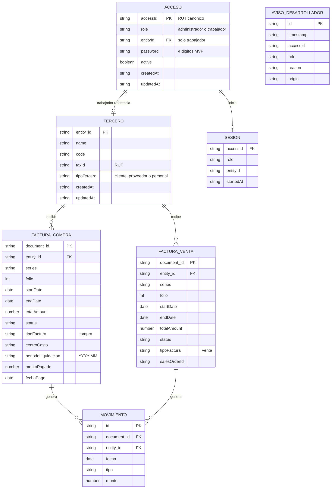

# Modelo de Datos: Acceso a liquidaciones de sueldo por RUT y contraseña

**Rama**: `002-payroll-access-control` · **Fecha**: 2026-11-11 · **Estado**: Borrador
**Relacionado con**: `spec.md`, `plan.md`, `research.md` y `contracts/`

## 1. Descripción general

El modelo agrega credenciales de acceso y una sesión por pestaña sobre el módulo de facturación y pagos. No crea una entidad de liquidación: la liquidación es una proyección de una factura de compra dirigida a un tercero de tipo personal. Las facturas de venta y de compra se guardan en colecciones separadas.

| Concepto | Tipo | Para qué existe |
|---|---|---|
| **Acceso (AccessRecord)** | Registro de credencial | Identifica a un administrador o trabajador por RUT y contraseña. |
| **Sesión (Session)** | Registro efímero en `sessionStorage` | Mantiene el rol y el vínculo mientras la pestaña está abierta. |
| **Notificación al desarrollador (DevNotification)** | Registro local de incidencia | Diagnostica RUT inválidos, duplicados, inactivos o con vínculo roto. |
| **Tercero (Entity)** | Registro de datos maestros existente | Contraparte; el tercero de tipo personal es el trabajador. |
| **Factura de venta (SaleInvoice)** | Registro transaccional | Documento por cobrar, en su propia colección. |
| **Factura de compra (PurchaseInvoice)** | Registro transaccional | Documento por pagar; si el tercero es personal, es la liquidación. |
| **Liquidación (PayrollSettlement)** | Proyección de `PurchaseInvoice` | Vista de solo lectura del trabajador y vista editable del administrador. |
| **Movimiento financiero (Movement)** | Registro derivado existente | Trazabilidad de emisiones y pagos; no se modifica su contrato. |

## 2. Entidad: AccessRecord (Acceso)

Credencial de entrada del MVP. Se guarda en `erp.accessRecords`.

| Campo | Tipo | Descripción | Restricciones |
|---|---|---|---|
| `accessId` | string | RUT canónico del usuario; clave primaria | Obligatorio, único, válido según `isValidRutChileno`, forma `CUERPO-DV` sin puntos. |
| `role` | string | Rol del usuario | Obligatorio. Valores: `administrador`, `trabajador`. |
| `entityId` | string \| null | `entity_id` del tercero personal asociado | Obligatorio para `trabajador`; debe existir y tener `tipoTercero = personal`. `null` para `administrador`. |
| `password` | string | Contraseña del MVP | Obligatoria, exactamente 4 dígitos. Al crear o restablecer debe ser igual a los primeros 4 dígitos del cuerpo del RUT. |
| `active` | boolean | Estado del acceso | Obligatorio. `true` por defecto. |
| `createdAt` | string | Fecha de creación (ISO 8601) | Obligatorio. |
| `updatedAt` | string | Fecha de última actualización (ISO 8601) | Obligatorio. |

**Invariantes**:
- `accessId` es único entre todos los accesos, comparado en forma canónica.
- Un `entityId` puede tener como máximo un acceso con `active = true`.
- Debe existir al menos un acceso con `role = administrador` y `active = true`.
- Un acceso de administrador no puede tener `entityId`.
- Un acceso de trabajador no puede quedar sin `entityId` ni apuntar a un tercero que no sea personal.
- La contraseña inicial y la restablecida se derivan del RUT; no se acepta otra en la creación.

## 3. Entidad: Session (Sesión)

Registro efímero en `sessionStorage` bajo `erp.session`. No se guarda en `localStorage`.

| Campo | Tipo | Descripción | Restricciones |
|---|---|---|---|
| `accessId` | string | RUT canónico del acceso autenticado | Obligatorio. |
| `role` | string | Rol de la sesión | Obligatorio. Valores: `administrador`, `trabajador`. |
| `entityId` | string \| null | Tercero personal asociado | Obligatorio para `trabajador`; `null` para `administrador`. |
| `startedAt` | string | Inicio de la sesión (ISO 8601) | Obligatorio. |

**Ciclo de vida**:
1. Se crea al validar credenciales y rol.
2. Se conserva al recargar la página dentro de la misma pestaña.
3. Se elimina al cerrar sesión.
4. El navegador la elimina al cerrar la pestaña.
5. Si al recuperarla el acceso ya no existe, está inactivo o cambió de rol, se descarta y se vuelve al login.

## 4. Entidad: DevNotification (Notificación al desarrollador)

Registro local en `erp.devNotifications`.

| Campo | Tipo | Descripción | Restricciones |
|---|---|---|---|
| `id` | string | Identificador único | Obligatorio, generado automáticamente. |
| `timestamp` | string | Fecha y hora del intento (ISO 8601) | Obligatorio. |
| `accessId` | string | RUT intentado, normalizado si es posible | Obligatorio; puede ser el texto original si el RUT es inválido. |
| `role` | string | Rol seleccionado en el intento | Obligatorio. Valores: `administrador`, `trabajador` o `desconocido`. |
| `reason` | string | Motivo del rechazo | Obligatorio. Valores: `INVALID_RUT`, `INACTIVE`, `DUPLICATE`, `BROKEN_ENTITY_LINK`, `NOT_FOUND`. |
| `origin` | string | Origen del intento | Obligatorio. Valor inicial: `login`. |

**Reglas**:
- Se registra una notificación por cada intento rechazado por las razones indicadas.
- No se registra una notificación por contraseña incorrecta ni por rol incompatible; esos son errores del usuario, no incidencias del desarrollador.
- El panel de avisos solo es visible para administradores.
- Las notificaciones no se eliminan automáticamente en el MVP; el administrador puede limpiarlas con confirmación.

## 5. Proyección: PayrollSettlement (Liquidación de sueldo)

No tiene almacenamiento propio. Se obtiene de `erp.purchaseInvoices` con estas reglas:
- `customFields.tipoFactura === 'compra'`;
- el `entity_id` corresponde a un tercero con `customFields.tipoTercero === 'personal'`;
- para la vista del trabajador, `entity_id === session.entityId`.

| Campo proyectado | Origen | Descripción |
|---|---|---|
| `documentId` | `document_id` | Identificador de la factura de compra. |
| `workerEntityId` | `entity_id` | Tercero personal (trabajador). |
| `workerName` | `Entity.name` | Nombre del trabajador. |
| `workerRut` | `Entity.taxId` | RUT del trabajador. |
| `periodo` | `customFields.periodoLiquidacion` | Período `YYYY-MM`. |
| `totalAmount` | `totalAmount` | Monto de la liquidación. |
| `status` | `status` | Estado del ciclo de vida: Borrador, Emitida o Pagada. |
| `fechaPago` | `customFields.fechaPago` | Fecha de pago, si existe. |
| `startDate` | `startDate` | Fecha de emisión. |
| `endDate` | `endDate` | Fecha de vencimiento. |
| `centroCosto` | `customFields.centroCosto` | Centro de costo de la compra. |

**Regla de liquidación vigente para el trabajador**:
1. Filtrar las facturas de compra del `entityId` de la sesión cuyo tercero sea personal.
2. Ordenar por `periodoLiquidacion` descendente.
3. Desempatar por `startDate` descendente.
4. Desempatar por `createdAt` descendente.
5. Mostrar solo la primera.

**Regla del administrador**: ve todas las liquidaciones (todas las facturas de compra a terceros personales), sin límite de período, y puede filtrar por trabajador/RUT y por período.

## 6. Entidades de facturación (existentes, con separación física)

### 6.1 SaleInvoice (Factura de venta)

Se guarda en `erp.salesInvoices`. Conserva los campos base de `Document` de `001` y la invariante `customFields.tipoFactura = 'venta'`.

| Campo | Tipo | Restricciones |
|---|---|---|
| `document_id` | string | Obligatorio, único dentro de la colección. |
| `entity_id` | string | Obligatorio; debe existir y ser de tipo `cliente`. |
| `series`, `folio` | string, number | Folio entero positivo; combinación serie/folio única dentro del tipo. |
| `startDate`, `endDate` | string | Fechas válidas; `endDate >= startDate`. |
| `subtotal`, `discount`, `taxAmount`, `totalAmount` | number | No negativos; descuento no mayor que subtotal; total obligatorio al emitir. |
| `status` | string | Borrador, Emitida o Pagada, según el ciclo de vida. |
| `customFields.tipoFactura` | string | Fijo en `venta`. |
| `customFields.salesOrderId` | string | Opcional; si se ingresa, no vacío. |

### 6.2 PurchaseInvoice (Factura de compra)

Se guarda en `erp.purchaseInvoices`. Conserva los campos base de `Document` de `001` y la invariante `customFields.tipoFactura = 'compra'`.

| Campo | Tipo | Restricciones |
|---|---|---|
| `document_id` | string | Obligatorio, único dentro de la colección. |
| `entity_id` | string | Obligatorio; debe existir y ser de tipo `proveedor` o `personal`. |
| `series`, `folio` | string, number | Folio entero positivo; combinación serie/folio única dentro del tipo. |
| `startDate`, `endDate` | string | Fechas válidas; `endDate >= startDate`. |
| `subtotal`, `discount`, `taxAmount`, `totalAmount` | number | No negativos; descuento no mayor que subtotal; total obligatorio al emitir. |
| `status` | string | Borrador, Emitida o Pagada. |
| `customFields.tipoFactura` | string | Fijo en `compra`. |
| `customFields.centroCosto` | string | `Activo` o `Consumible`; obligatorio al emitir. |
| `customFields.periodoLiquidacion` | string | `YYYY-MM`; obligatorio cuando el tercero es personal y no posterior a la emisión. |
| `customFields.montoPagado`, `customFields.fechaPago` | number, date | Obligatorios al marcar Pagada; `montoPagado = totalAmount`. |

### 6.3 UnclassifiedDocument (Documento no clasificado)

Se guarda en `erp.unclassifiedDocuments`. Recibe los documentos legados que no tienen `customFields.tipoFactura` o cuyo valor no es `venta` ni `compra`.

- No se muestran en las vistas de factura ni en la liquidación.
- El administrador ve un aviso con la cantidad de documentos no clasificados.
- Se conservan para no perder datos durante la migración.

## 7. Entidad: Entity (Tercero)

Se mantiene el modelo de `001`. Campos relevantes para esta funcionalidad:

| Campo | Tipo | Uso en esta funcionalidad |
|---|---|---|
| `entity_id` | string | Vínculo con accesos y facturas. |
| `name` | string | Nombre del trabajador en la liquidación. |
| `code` | string | Código interno. |
| `taxId` | string | RUT del tercero; debe coincidir con el RUT del acceso cuando el tercero es personal. |
| `customFields.tipoTercero` | string | `personal` identifica al trabajador; `cliente` y `proveedor` se usan en las facturas. |

## 8. Entidad: Movement (Movimiento financiero)

Se mantiene el contrato de `001`. Se genera a partir de las facturas y no se edita manualmente. La separación física no cambia su estructura ni su cálculo. Al eliminar una factura se eliminan sus movimientos, sin importar la colección de origen.

## 9. Relaciones

- Un `AccessRecord` de trabajador referencia exactamente un `Entity` personal por `entityId`.
- Un `AccessRecord` de administrador no referencia ningún `Entity`.
- Un `Entity` personal puede tener cero o un `AccessRecord` activo.
- Una `PurchaseInvoice` pertenece a un `Entity`; si el `Entity` es personal, la factura es una liquidación.
- Una `SaleInvoice` pertenece a un `Entity` de tipo cliente.
- Un `Movement` pertenece a una factura por `document_id` y a un tercero por `entity_id`.
- Una `Session` referencia un `AccessRecord` por `accessId` y conserva una copia del rol y del `entityId`.

## 10. Reglas de validación

**Acceso**
- RUT válido, único y normalizado.
- Rol en `{administrador, trabajador}`.
- Trabajador: `entityId` obligatorio, existente y de tipo personal.
- Administrador: `entityId` debe ser `null`.
- Contraseña de exactamente 4 dígitos; al crear o restablecer, igual a los primeros 4 dígitos del cuerpo del RUT.
- No se puede desactivar ni eliminar el último administrador activo.
- No se puede tener dos accesos activos para el mismo `entityId`.
- No se puede duplicar un `accessId` normalizado.

**Sesión**
- Debe corresponder a un acceso existente y activo.
- El rol de la sesión debe coincidir con el rol del acceso.
- Un trabajador debe conservar un `entityId` válido y personal.

**Liquidación**
- La factura de compra debe tener `periodoLiquidacion` en `YYYY-MM`.
- El período no puede ser posterior a la fecha de emisión.
- El tercero debe ser de tipo personal.
- El monto total no puede ser negativo.
- El estado debe respetar el ciclo de vida Borrador → Emitida → Pagada.
- Para marcar Pagada se requiere `montoPagado = totalAmount` y `fechaPago`.

**Separación de facturas**
- `erp.salesInvoices` solo contiene `tipoFactura = venta`.
- `erp.purchaseInvoices` solo contiene `tipoFactura = compra`.
- Un documento no puede existir simultáneamente en ambas colecciones con el mismo `document_id`.
- El tipo se fija por la vista y no se puede cambiar desde el formulario.

## 11. Transiciones de estado

### Acceso

| Estado actual | Acción | Estado siguiente | Regla |
|---|---|---|---|
| Activo | Desactivar | Inactivo | No permitido si es el último administrador activo. |
| Inactivo | Reactivar | Activo | No permitido si otro acceso activo usa el mismo `entityId`. |
| Activo/Inactivo | Restablecer contraseña | Sin cambio de estado | La contraseña vuelve a los primeros 4 dígitos del RUT. |

### Factura (sin cambios respecto de `001`)

| Estado actual | Acción | Estado siguiente | Regla |
|---|---|---|---|
| Borrador | Emitir | Emitida | Requiere total y, en compra, centro de costo; en personal, período. |
| Emitida | Pagar | Pagada | Requiere `montoPagado = totalAmount` y `fechaPago`. |
| Pagada | — | — | Sin transiciones. |

## 12. Almacenamiento y migración

| Clave | Contenido | Persistencia |
|---|---|---|
| `erp.entities` | Terceros | `localStorage` |
| `erp.salesInvoices` | Facturas de venta | `localStorage` |
| `erp.purchaseInvoices` | Facturas de compra y liquidaciones | `localStorage` |
| `erp.unclassifiedDocuments` | Documentos legados sin tipo | `localStorage` |
| `erp.accessRecords` | Accesos por RUT | `localStorage` |
| `erp.devNotifications` | Incidencias para el desarrollador | `localStorage` |
| `erp.movements` | Movimientos financieros | `localStorage` |
| `erp.schemaVersion` | Versión del esquema (`2.0.0`) | `localStorage` |
| `erp.migration.invoiceSplit` | Marca de migración completada | `localStorage` |
| `erp.session` | Sesión activa | `sessionStorage` |

**Migración desde `001`**:
1. Leer `erp.documents` si existe.
2. Separar por `customFields.tipoFactura`.
3. Insertar en `erp.salesInvoices` o `erp.purchaseInvoices` sin duplicar por `document_id`.
4. Enviar los documentos sin tipo a `erp.unclassifiedDocuments`.
5. Verificar que la suma de registros migrados coincide con el total leído.
6. Eliminar `erp.documents` solo si la verificación es correcta.
7. Marcar `erp.migration.invoiceSplit = done` y `erp.schemaVersion = 2.0.0`.
8. Si algo falla, conservar `erp.documents` y mostrar un aviso al administrador.

## 13. Modelo Entidad-Relación

## 14. Notas de extensibilidad

- **Etapa futura 1**: agregar cambio obligatorio de contraseña en el primer ingreso y recuperación de contraseña.
- **Etapa futura 2**: historial completo de liquidaciones para el trabajador y pagos parciales.
- **Etapa futura 3**: backend real con autenticación, autorización del lado del servidor y cifrado.
- **Etapa futura 4**: permisos granulares y auditoría completa de accesos.
- **Etapa futura 5**: si se requiere, separar también los movimientos por tipo de factura; en el MVP se mantiene una sola colección derivada.
